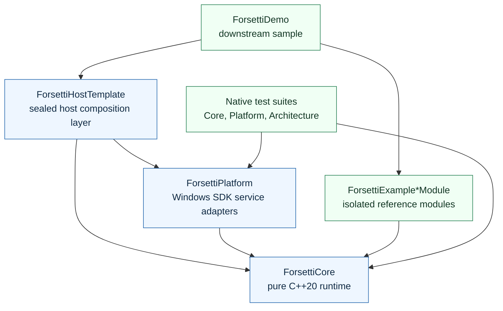
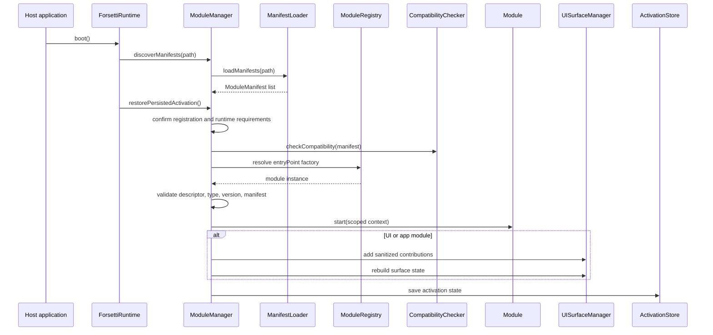

# Forsetti Framework - Windows

**Consumer applications must not copy or vendor this repository as their starting tree.** Read the complete [Windows consumption policy](CONSUMPTION_POLICY.md). Install the [Forsetti Windows SDK](SDK/README.md) outside application source, consume its installed CMake products, and generate app-owned files from approved scaffolds.

The framework and SDK version is **0.2.0**, aligned with the root CMake project, vcpkg manifest, and `ForsettiVersion::current`. The x64 SDK supplies separately mapped Debug/Release static libraries for Core, Platform, and HostTemplate, their public headers, consumer tools, templates, and documentation. See [SDK compatibility](SDK/Documentation/Compatibility.md) for dependency/toolchain requirements and the packaged `sdk-manifest.json` for exact artifact provenance and verification evidence.

Forsetti Framework - Windows is a modular runtime framework for Windows 11 applications. It is built with C++20, MSVC, CMake, vcpkg, and native Windows SDK service adapters.

The framework centers on a compatibility-governed module model: modules declare identity, platform support, capabilities, entitlement requirements, and optional UI contributions. The runtime validates those declarations before activation, scopes module access to approved services, and keeps UI surface state under framework control.

The repository now includes the sealed `ForsettiHostTemplate` composition layer, Windows platform adapters, isolated example modules, downstream demo wiring, module templates, and native test suites.

## What Forsetti Provides

| Area | Repository Contract |
|---|---|
| Module lifecycle | Manifest discovery, compatibility validation, entitlement checks, activation, deactivation, and restore diagnostics |
| Service modules | Multiple service modules can run concurrently |
| UI/app modules | UI and app modules share one active surface slot |
| Capability governance | Runtime service access and UI contribution features are scoped to declared capabilities |
| Module communication | Module-to-module messages are framework-mediated and source identity is assigned by scoped context |
| UI composition | Toolbar items, view injections, and overlay schemas are contributed by the active UI/app module |
| Platform services | WinHTTP networking, Registry storage, DPAPI secure storage, constrained local file export, and no-op telemetry |
| Guardrails | Local scripts verify build, tests, dependency boundaries, manifests, compatibility checks, and script regressions |

## Architecture At A Glance



The hard dependency rule is one-way only:

- `ForsettiCore` depends on nothing in the repository.
- `ForsettiPlatform` depends on `ForsettiCore`.
- `ForsettiHostTemplate` depends on `ForsettiCore` and `ForsettiPlatform`.
- `ForsettiExampleServiceModule`, `ForsettiExampleUIModule`, and `ForsettiExampleAppModule` each depend on `ForsettiCore` and not on each other.
- `samples/ForsettiDemo` is downstream demonstration code and may compose the host and example modules.
- Reverse and lateral includes are blocked by tests and scripts.

## Runtime Flow



Activation fails before `start()` when compatibility, entitlement, capability, or factory identity checks fail. UI/app activation preserves the single active surface slot and cleans up the previous active UI/app module.

## Repository Layout

| Path | Purpose |
|---|---|
| `include/ForsettiCore` | Public runtime, module, manifest, event, service, capability, and UI surface contracts |
| `src/ForsettiCore` | Core runtime implementation with no platform dependencies |
| `include/ForsettiPlatform` | Public Windows platform adapter contracts |
| `src/ForsettiPlatform` | Windows SDK implementations for networking, storage, secure storage, file export, and telemetry |
| `include/ForsettiHostTemplate` | Public host controller, bootstrap, overlay router, state, and surface adapter contracts |
| `src/ForsettiHostTemplate` | Sealed host composition implementation |
| `src/ForsettiExampleServiceModule` | Isolated reference service module and manifest |
| `src/ForsettiExampleUIModule` | Isolated reference UI module and manifest |
| `src/ForsettiExampleAppModule` | Isolated reference app module and manifest |
| `samples/ForsettiDemo` | Downstream demonstration composition root |
| `templates` | Windows module and host starter templates |
| `tests` | Native CppUnitTest suites surfaced through CTest |
| `Scripts` | Local guardrail, compatibility, manifest, dependency, and discussion automation scripts |
| `.github` | Pull request template, label/release metadata, and discussion automation config; no hosted workflows are present in this checkout |
| `docs/governance` | Repository-grounded governance and discussion automation documents |
| `.forsetti/alignment` | Phase evidence and acceptance reports for runtime-boundary alignment work |

## Build And Test

The commands below build the framework-maintenance checkout. Application onboarding uses the installed package and [SDK Getting Started](SDK/Documentation/Getting-Started.md), with `find_package(ForsettiFramework CONFIG REQUIRED)` and selected `Forsetti::` products.

### Prerequisites

- Windows 11
- Visual Studio 2022 with the Desktop development with C++ workload
- CMake 3.28 or newer
- vcpkg with `VCPKG_ROOT` set
- PowerShell 7 or Windows PowerShell

### Configure, Build, And Test

```powershell
cmake --preset debug
cmake --build --preset debug
ctest --preset debug --output-on-failure
```

The repository currently defines `debug` and `release` CMake presets. The package-level `windows-msvc-debug` name is not a repository preset.

### Full Local Guardrail Wrapper

Run this for full local verification:

```powershell
.\Scripts\verify-forsetti-guardrails.ps1
```

The wrapper performs:

1. CMake configure with the `debug` preset.
2. CMake build with the `debug` preset.
3. CTest execution.
4. Architecture checks.
5. Dependency checks.
6. Manifest validation.
7. Pull request compatibility checks.
8. Script regression tests.
9. SDK scaffold and integration-tool regression fixtures in Windows PowerShell and PowerShell 7.

### Build, Package, And Verify The SDK

Use PowerShell 7.2 or newer, a working external `VCPKG_ROOT`, and Visual Studio 2022 native C++ tools. Read [CONSUMPTION_POLICY.md](CONSUMPTION_POLICY.md) before changing distribution inputs. `templates/` contains the canonical scaffold payloads; `SDK/` contains curated consumer documents/tools. SDK assembly selects approved files explicitly; it does not copy a repository and remove unwanted content afterward.

From a reviewed, clean source commit:

```powershell
pwsh -NoProfile -File .\Scripts\Build-ForsettiSDK.ps1
$recordPath = Join-Path $PWD 'out\sdk\latest-build.json'
$record = Get-Content -LiteralPath $recordPath -Raw | ConvertFrom-Json
$verificationRoot = Join-Path $env:TEMP ('Forsetti SDK verification ' + [guid]::NewGuid().ToString('N'))
pwsh -NoProfile -File .\Scripts\Verify-ForsettiSDK.ps1 `
    -Archive $record.archive -BuildRecord $recordPath -WorkRoot $verificationRoot
```

The build command creates a source snapshot under ignored `out/sdk/`, builds/installs all three products in Debug and Release, and writes the archive, external `SHA256SUMS`, logs, and build record. `-VisualStudioInstance <path>` selects an installed VS 2022 instance explicitly. `-AllowDirty` is for an unverified candidate; it is not release verification.

The verifier extracts/relocates the archive outside the framework worktree, temporarily makes that snapshot's source/build paths unavailable, resolves the declared separate dependency, and checks independent consumers, public headers, runtime success/rejection, native presentation, payload hashes, and negative fixtures. It restores the original paths and writes `Verification-Results.json` under the selected verification directory. Run the normal maintainer Debug/Release CTest and guardrails separately; consumer verification does not replace them.

After passing verification of clean source, assemble a new output with that report:

```powershell
$verifiedOutput = Join-Path $PWD ('out\sdk\verified-' + [guid]::NewGuid().ToString('N'))
pwsh -NoProfile -File .\Scripts\Package-ForsettiSDK.ps1 `
    -SourceRoot $record.sourceRoot -InstallRoot $record.installRoot `
    -BuildRoot $record.buildRoot -SourceRevision $record.sourceRevision `
    -OutputDirectory $verifiedOutput `
    -VerificationReport (Join-Path $verificationRoot 'Verification-Results.json')
```

Review the final archive inventory, complete policy bytes/hash against the selected Git commit, version sources, dependency/toolchain settings, executed results, and external ZIP checksum. Repeated assembly from the same built payload supports comparison; independently rebuilt MSVC binary identity is not promised. Keep staging/build outputs ignored and synchronize the selected release commit/tag with the local checkout when publishing.

## Module Manifest Baseline

Manifests live under `ForsettiManifests` directories and use JSON with exact platform/capability casing. Schema `1.0` remains loadable with safe default runtime requirements; current manifests use schema `1.1`:

```json
{
  "schemaVersion": "1.1",
  "manifestTemplateVersion": "1.1",
  "moduleID": "com.forsetti.module.example-service",
  "displayName": "Example Service",
  "moduleVersion": { "major": 0, "minor": 1, "patch": 0, "prerelease": null },
  "moduleType": "service",
  "supportedPlatforms": ["Windows"],
  "minForsettiVersion": { "major": 0, "minor": 2, "patch": 0, "prerelease": null },
  "maxForsettiVersion": null,
  "capabilitiesRequested": ["storage", "telemetry"],
  "iapProductID": null,
  "entryPoint": "ExampleServiceModule",
  "defaultModuleRole": null,
  "runtimeRequirements": {
    "io": [
      {
        "requirementID": "storage.example-state",
        "kind": "storage",
        "access": "read_write",
        "required": true,
        "description": "Private example service state."
      }
    ],
    "ui": null,
    "dataIsolation": {
      "mode": "private_to_module",
      "ownedStoreIDs": ["example-service-state"],
      "requiredDefaultRoles": []
    }
  }
}
```

Supported module types are `service`, `ui`, and `app`.

Module-requestable capabilities are:

- `networking`
- `storage`
- `secure_storage`
- `file_export`
- `crypto_utilities`
- `telemetry`
- `routing_overlay`
- `toolbar_items`
- `view_injection`
- `event_publishing`
- `shared_database`
- `authentication`
- `diagnostics`
- `api`
- `security`

The runtime also recognizes `ui_theme_mask` for declared, policy-approved UI theme IDs. Framework host chrome remains framework-owned.

## Documentation Map

Repository documents:

- `README.md` - primary repository entry point.
- `CHANGELOG.md` - release and notable change history.
- `CONTRIBUTING.md` - open-source use policy; outside contributions are not accepted.
- `wiki.md` - tracked index for the historical public GitHub Wiki.
- `docs/governance/github-discussion-automation.md` - discussion automation design.
- `docs/governance/discussion_moderation_policy.md` - discussion moderation policy.
- `implementation-policy.json` - machine-readable coding policy and invariants.
- `framework-policy.json` - machine-readable framework architecture and API summary.
- [CONSUMPTION_POLICY.md](CONSUMPTION_POLICY.md) - complete Windows supported-integration boundary, also shipped unchanged in the SDK.
- [SDK/README.md](SDK/README.md) - installed SDK onboarding, tools, and consumer documentation.

Historical public Wiki:

- [Forsetti Framework - Windows Wiki](https://github.com/flynn33/Forsetti-Framework-Windows/wiki)

The live Wiki is a historical reference for architecture and runtime concepts. Its licensing, workflow, and native-validation statements have not been brought into alignment with the current repository and SDK. Use the repository's [LICENSE](LICENSE), [consumption policy](CONSUMPTION_POLICY.md), [SDK documentation](SDK/README.md), and the installed `sdk-manifest.json` as the current authority. The tracked `wiki.md` indexes the historical pages; it does not establish that the live pages are current.

## Current Alignment Status

Runtime-boundary alignment is merged into `main`, and evidence is tracked under `.forsetti/alignment`. The canonical local verification path remains `.\Scripts\verify-forsetti-guardrails.ps1` on a Windows/MSVC environment with CMake, CTest, PowerShell, and `VCPKG_ROOT` available.

Historical alignment reports are not verification of a new SDK archive. Record current native Debug/Release builds, CTest/guardrails, relocated clean-consumer runs, native presentation checks, policy equality, inventory, and archive hashes in the SDK manifest and accompanying verification evidence. Do not infer an archive's release readiness from an old test count.

## Patent Notice

The architecture and design of Forsetti are the subject of a pending U.S. patent application:
**Compatibility-Governed, Entitlement-Aware Modular Runtime Framework for Native Application Modules** - U.S. Application No. 63/999,606, filed March 8, 2026. Patent Pending.

## Contributing

This project is licensed under the Apache License, Version 2.0. See [LICENSE](LICENSE).

Outside contributions to this repository are not accepted. Pull requests and collaboration requests will not be reviewed or merged. See [CONTRIBUTING.md](CONTRIBUTING.md).

## License

Copyright (c) 2026 James Daley, Raven Forge Software

The Forsetti Framework for Windows is licensed under the Apache License, Version 2.0. See [LICENSE](LICENSE) and [NOTICE](NOTICE).

You may use, modify, and distribute this project, including for commercial purposes. The copyright stays with James Daley, Raven Forge Software.

You must give credit to James Daley, Raven Forge Software, for the Forsetti Framework for Windows. Keep that credit with every copy or product that uses this work. Keep the LICENSE and NOTICE files, keep the copyright lines in the source, and state the changes you make.
