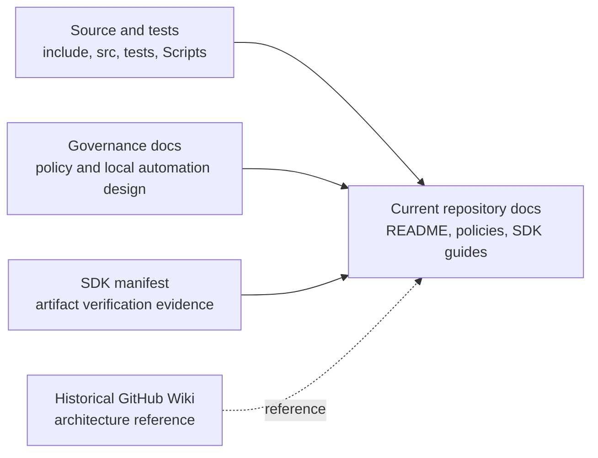

# Forsetti Framework - Windows Wiki Index

This file is the repository-tracked index for the historical public GitHub Wiki:

https://github.com/flynn33/Forsetti-Framework-Windows/wiki

The live Wiki remains a historical reference for architecture and runtime concepts. Its licensing, workflow, and native-validation statements are outdated. The current repository [LICENSE](LICENSE), [consumption policy](CONSUMPTION_POLICY.md), [SDK documentation](SDK/README.md), and installed `sdk-manifest.json` govern current use, compatibility, and artifact evidence. This index does not claim that the live pages match those documents.

The current framework/SDK version is **0.2.0**. Consumer onboarding starts with the [installed Windows SDK](SDK/README.md) and complete [consumption policy](CONSUMPTION_POLICY.md); the development repository and Wiki material are references, not an application starting tree. Installed public C++ headers remain SDK-owned interfaces; only approved scaffold outputs become app-owned code.

## Historical Wiki Page Set

| Page | Purpose |
|---|---|
| `Home` | Orientation, status, page map, and high-level diagrams |
| `Architecture` | Layering rules, component graph, dependency boundaries, and repository layout |
| `Runtime-Lifecycle` | Boot, discovery, registration confirmation, activation, deactivation, restore, and entitlement reconciliation |
| `Module-System` | Module types, schema 1.1 manifests, runtime requirements, registry factories, compatibility, and examples |
| `Capabilities-and-Security` | Capability policy, scoped service access, default roles, messaging rules, and reserved namespaces |
| `UI-Surface-Model` | UI/app activation, declared UI IDs, toolbar items, view injections, overlays, and theme mask policy |
| `Platform-Services` | WinHTTP, Registry, DPAPI, local file export, telemetry, registration persistence, digesting, and view factories |
| `Build-and-Testing` | Prerequisites, CMake presets, CTest, guardrail scripts, hosted checks, and validation blockers |
| `API-Reference` | Public headers, interfaces, value types, enums, platform services, and host template contracts |
| `Coding-Policy` | Engineering rules, dependency invariants, style expectations, and verification policy |
| `Governance-and-Operations` | Repository automation, discussion routing, moderation, PR workflow, and evidence policy |
| `Roadmap-and-Risks` | Native validation blockers, remote workflow restoration, dependency pinning, and future hardening |

## Documentation Architecture



## Update Rules

- Update `README.md` when onboarding, build, validation, architecture, or release status changes.
- Update `CHANGELOG.md` for notable runtime, validation, governance, or documentation changes.
- Keep current behavior, examples, and verification guidance in tracked repository and SDK documents. Publishing updates to the live Wiki requires separate authorization.
- Update `docs/governance` when repository automation, discussion routing, moderation, or owner-facing policy changes.
- Keep `framework-policy.json` and `implementation-policy.json` aligned with the source and public docs.

## Current Local Documentation And Verification

Historical runtime-boundary alignment evidence is tracked under `.forsetti/alignment`. The current local Windows validation path is:

```powershell
.\Scripts\verify-forsetti-guardrails.ps1
```

The wrapper configures, builds, runs CTest, checks architecture and dependency boundaries, validates manifests, runs pull request compatibility checks, and runs script and SDK-tool regression tests. Use the SDK manifest and release verification record for current native Debug/Release and relocated consumer evidence; historical status text does not establish a new archive's readiness. See [SDK Getting Started](SDK/Documentation/Getting-Started.md), [Compatibility](SDK/Documentation/Compatibility.md), and [Source References](SDK/Documentation/Source-References.md) for edition-specific installation and immutable provenance.
